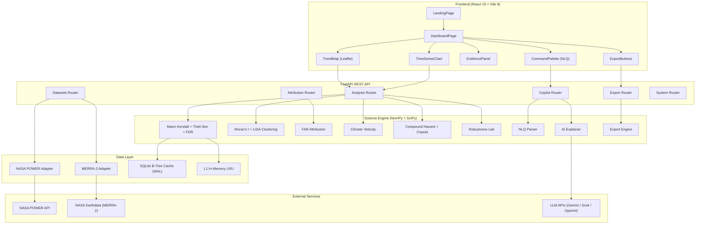

# Tellura

**Spatiotemporal trend detection for NASA Earth observations.**

Tellura is a full-stack scientific workstation that detects, maps, and explains statistically significant trends in NASA satellite climate data. It applies non-parametric statistical methods — Mann-Kendall tests with Hamed & Rao autocorrelation correction, Theil-Sen robust slope estimation, Pettitt changepoint detection, and Benjamini-Hochberg false discovery rate control — to gridded reanalysis datasets, then visualizes the results as interactive spatial maps with LISA clustering. Built for the [NASA Space Apps Challenge 2026](https://www.spaceappschallenge.org/2026/challenges/be-an-earth-system-trend-detective/) "Be an Earth System Trend Detective" challenge.

[](LICENSE)
[](https://python.org)
[](https://github.com/ShivamGawade-XS/NSC/actions/workflows/ci.yml)

---

## Screenshots

<p align="center">
  
</p>

<p align="center">
  
</p>

<p align="center">
  
</p>

---

## Key Features

- **Non-parametric trend detection** — Mann-Kendall S test with Hamed & Rao (1998) variance correction for autocorrelated time series, applied per grid cell across the full spatial domain (`backend/app/science/trend.py`)
- **Robust slope estimation** — Theil-Sen median slope with Gilbert (1987) confidence intervals, resistant to outliers (`backend/app/science/trend.py`)
- **False discovery rate control** — Benjamini-Hochberg FDR correction across all grid cells, preventing false positives from multiple testing (`backend/app/science/trend.py`)
- **Pettitt changepoint detection** — Identifies structural breaks in temporal series (`backend/app/science/trend.py`)
- **Spatial autocorrelation** — Global Moran's I and Local Indicators of Spatial Association (LISA) to identify hot/cold spot clusters (`backend/app/science/spatial.py`)
- **Compound hazard analysis** — Multi-variable hazard assessment with copula-based joint exceedance modeling (`backend/app/science/compound.py`, `backend/app/science/copula_hazard.py`)
- **Extreme event attribution** — Fraction of Attributable Risk (FAR) framework based on Stott, Stone & Allen (2004) (`backend/app/science/attribution.py`)
- **Climate velocity mapping** — Spatial velocity of isotherms following Burrows et al. (Nature, 2011) (`backend/app/science/climate_velocity.py`)
- **Robustness lab** — Bootstrap resampling, jackknife leave-one-out, and temporal window sweep to stress-test detected trends (`backend/app/science/robustness.py`)
- **Natural language queries** — Parse plain-English scientific questions into structured analysis parameters (`backend/app/science/nlq_parser.py`)
- **AI evidence explainer** — Cascading LLM integration (Gemini → xAI Grok → OpenAI → deterministic template) for narrative interpretation of results (`backend/app/science/explainer.py`)
- **Multi-format export** — CF-1.8 NetCDF-4, GeoJSON, LaTeX statistical reports, and reproducible Jupyter/Colab notebooks (`backend/app/science/export.py`)
- **Two NASA data sources** — MERRA-2 reanalysis (GMAO) and NASA POWER (Langley), with a pluggable adapter pattern for adding more (`backend/app/adapters/`)
- **Interactive map workstation** — Leaflet-based spatial visualization with NASA GIBS satellite imagery basemaps, cell-level drilldown, and real-time chart rendering (`frontend-react/src/components/TrendMap.jsx`)

---

## Tech Stack

### Backend
| Component | Version | Purpose |
| :--- | :--- | :--- |
| Python | 3.12+ | Runtime |
| FastAPI | ≥ 0.110.0 | REST API framework |
| Uvicorn | ≥ 0.28.0 | ASGI server |
| NumPy | ≥ 1.26.0 | Array computation |
| SciPy | ≥ 1.12.0 | Statistical tests |
| xarray | ≥ 2024.1.0 | Multidimensional labeled data |
| netCDF4 + h5netcdf | ≥ 1.6.5 / ≥ 1.3.0 | NetCDF I/O engines |
| SQLite (WAL mode) | stdlib | L2 persistent cache with HMAC-SHA256 integrity |
| SlowAPI | ≥ 0.1.9 | Rate limiting |

### Frontend
| Component | Version | Purpose |
| :--- | :--- | :--- |
| React | 19 | UI framework |
| Vite | 8 | Build tool and dev server |
| Tailwind CSS | 4 | Utility-first styling |
| Leaflet | 1.9.4 | Interactive maps |
| Chart.js + react-chartjs-2 | 4.5 / 5.3 | Time series charts |
| Framer Motion | 14 | Animations |
| KaTeX | 0.19 | LaTeX math rendering |
| Zustand | 5 | State management |

### Tooling
| Tool | Purpose |
| :--- | :--- |
| Ruff | Python linting |
| Pyright | Python static type checking |
| Oxlint | JavaScript/JSX linting |
| Pytest + Hypothesis | Backend testing (352 tests) |
| Playwright | End-to-end browser testing |

---

## Architecture



The frontend is a single-page React application that communicates with the FastAPI backend through a versioned REST API (`/api/v1/`). In development, Vite proxies API requests to the backend on port 8000. In production, FastAPI serves the built SPA directly alongside the API from a single process.

The science engine is a set of pure-function modules that take NumPy arrays as input and return structured results. The data layer abstracts over two NASA data sources through a common adapter interface, with a two-tier cache (in-memory LRU + SQLite with HMAC-signed entries) to avoid redundant computation.

---

## Project Structure

```
.
├── backend/
│   ├── app/
│   │   ├── adapters/          # NASA data source adapters (MERRA-2, POWER)
│   │   ├── api/
│   │   │   ├── endpoints.py   # Router aggregator (façade)
│   │   │   ├── routers/       # Modular route handlers by domain
│   │   │   └── shared.py      # Shared state, caches, helpers
│   │   ├── core/              # Config, auth, caching, rate limiting, logging
│   │   ├── schemas/           # Pydantic request/response models
│   │   ├── science/           # Statistical engines (12 modules)
│   │   └── main.py            # FastAPI application entry point
│   ├── data/fixtures/         # Baseline NetCDF test fixtures
│   ├── tests/                 # 352 backend tests
│   ├── requirements.in        # Abstract dependencies
│   └── requirements.txt       # Pinned dependencies
├── frontend-react/
│   ├── src/
│   │   ├── components/        # 26 React components
│   │   ├── pages/             # 6 page components
│   │   ├── store/             # Zustand state management
│   │   ├── utils/             # Helpers, analytics, audio, storage
│   │   ├── workers/           # Web Worker for off-main-thread computation
│   │   └── api/client.js      # API client with LRU cache
│   ├── public/                # Static assets, favicons, manifest
│   └── vite.config.js         # Vite config with API proxy
├── notebooks/                 # 6 reproducible Colab notebooks
├── scripts/                   # Operational and test scripts
├── tests/e2e/                 # 12 Playwright E2E test specs
├── monitoring/                # Prometheus alerts + Grafana dashboard
├── docs/                      # 23 documentation files
├── Dockerfile                 # Multi-stage production build
├── docker-compose.yml         # Container orchestration
└── .github/workflows/         # CI + Security pipelines
```

---

## Getting Started

### Prerequisites

- **Python 3.12+** — [python.org/downloads](https://www.python.org/downloads/)
- **Node.js 22+** — [nodejs.org](https://nodejs.org/)
- **pip** (included with Python)
- **npm** (included with Node.js)

No database server, Docker, or external API keys are required to run locally. Tellura ships with built-in MERRA-2 fixture data and operates in "Verified Local Fixture Mode" by default.

### Install

```bash
# Clone the repository
git clone https://github.com/ShivamGawade-XS/NSC.git
cd NSC

# Install backend dependencies
pip install -r backend/requirements.txt

# Install frontend dependencies
npm ci --prefix frontend-react
```

### Set up environment (optional)

```bash
cp .env.example .env
# Edit .env to add API keys for AI copilot, NASA Earthdata, etc.
# All variables are optional — the app runs without any of them.
```

### Run (development)

Start the backend and frontend in two terminals:

```bash
# Terminal 1: Start the FastAPI backend (port 8000)
python -m uvicorn app.main:app --app-dir backend --host 127.0.0.1 --port 8000 --reload

# Terminal 2: Start the Vite dev server (port 3000, proxies /api to backend)
npm run --prefix frontend-react dev
```

Open [http://localhost:3000](http://localhost:3000) in your browser.

### Run (production build)

```bash
# Build the frontend
npm run --prefix frontend-react build

# Start the server (serves both API and SPA)
python -m uvicorn app.main:app --app-dir backend --host 0.0.0.0 --port 8000
```

Open [http://localhost:8000](http://localhost:8000).

---

## Environment Variables

All variables are optional for local development. The app runs with sensible defaults.

| Variable | Purpose | Default |
| :--- | :--- | :--- |
| `GEMINI_API_KEY` | Google Gemini API key for AI copilot | _(falls through to next provider)_ |
| `XAI_API_KEY` | xAI Grok API key (fallback) | _(falls through)_ |
| `OPENAI_API_KEY` | OpenAI API key (fallback) | _(deterministic template)_ |
| `DAILY_LLM_CALL_LIMIT` | Max external LLM calls per day | `200` |
| `EARTHDATA_USERNAME` | NASA Earthdata Login username | _(uses local fixtures)_ |
| `EARTHDATA_PASSWORD` | NASA Earthdata Login password | _(uses local fixtures)_ |
| `EARTHDATA_TOKEN` | NASA Earthdata bearer token | _(uses local fixtures)_ |
| `SMTP_HOST` | SMTP server for contact form | `smtp.gmail.com` |
| `SMTP_PORT` | SMTP port | `587` |
| `SMTP_USER` | SMTP sender address | — |
| `SMTP_PASSWORD` | SMTP password / app password | _(falls back to local JSON inbox)_ |
| `CONTACT_RECIPIENT_EMAIL` | Contact form recipient | — |
| `ENVIRONMENT` | `development` or `production` | `development` |
| `SECRET_KEY` | HMAC-SHA256 key for cache integrity (≥32 chars in production) | Dev fallback provided |
| `TELLURA_DB_PATH` | SQLite cache file path | OS-specific default |
| `CACHE_MAX_SIZE` | Max L1 in-memory cache entries | `256` |
| `MAX_BBOX_DEGREES` | Maximum bounding box span per axis | `180.0` |
| `DEFAULT_FDR_ALPHA` | FDR significance threshold | `0.05` |
| `HOST` | Server bind address | `127.0.0.1` |
| `PORT` | Server port | `8000` |
| `STRICT_ZERO_SYNTHETIC` | Block synthetic data generation | `true` |
| `VITE_API_URL` | Frontend API base URL override | Auto-detected from `window.location` |

See [`.env.example`](.env.example) for the full annotated template.

---

## Usage

### API Overview

All endpoints are available under `/api/v1/`. Interactive API documentation is at [`/docs`](http://localhost:8000/docs) (Swagger UI) and [`/redoc`](http://localhost:8000/redoc) in development mode.

### Health Check

```bash
curl http://localhost:8000/api/v1/health
```

```json
{
  "status": "healthy",
  "service": "Tellura Scientific API",
  "version": "1.0.0",
  "engine": "Mann-Kendall + Theil-Sen + Benjamini-Hochberg FDR",
  "adapters": ["merra2_reanalysis", "nasa_power"]
}
```

### List Datasets

```bash
curl http://localhost:8000/api/v1/datasets
```

```json
[
  { "dataset_id": "merra2_reanalysis", "name": "NASA MERRA-2 Atmospheric Reanalysis" },
  { "dataset_id": "nasa_power", "name": "NASA POWER Climate Reanalysis (NASA Langley)" }
]
```

### Run a Trend Analysis

```bash
curl -X POST http://localhost:8000/api/v1/analysis \
  -H "Content-Type: application/json" \
  -d '{
    "dataset_id": "merra2_reanalysis",
    "variable_id": "T2M",
    "start_year": 2000,
    "end_year": 2020,
    "bbox": [-100.0, 30.0, -90.0, 40.0],
    "alpha": 0.05,
    "use_fdr": true
  }'
```

```json
{
  "analysis_id": "ana_merra2_reanalysis_T2M_2000_2020_b-100_30_-90_40_a50",
  "status": "completed",
  "dataset_id": "merra2_reanalysis",
  "variable_id": "T2M",
  "variable_name": "2-Meter Air Temperature",
  "display_units": "°C",
  "time_span": "2000 - 2020",
  "summary": {
    "total_cells": 121,
    "significant_cells_fdr": 0,
    "mean_slope": 0.6035,
    "spatial_autocorrelation": {
      "moran_i": -0.0326,
      "p_value": 0.6162,
      "is_clustered": false,
      "interpretation": "Spatial distribution is consistent with random spatial variation."
    }
  }
}
```

### Key Endpoints

| Method | Endpoint | Description |
| :--- | :--- | :--- |
| `GET` | `/api/v1/health` | Health check |
| `GET` | `/api/v1/datasets` | List available datasets |
| `GET` | `/api/v1/variables` | List all climate variables |
| `POST` | `/api/v1/analysis` | Run trend analysis on a region |
| `GET` | `/api/v1/analysis/{id}` | Retrieve analysis results |
| `GET` | `/api/v1/analysis/{id}/map` | Get spatial map grid data |
| `GET` | `/api/v1/analysis/{id}/cell` | Get cell-level timeseries |
| `GET` | `/api/v1/analysis/{id}/velocity` | Get climate velocity field |
| `GET` | `/api/v1/analysis/{id}/signals` | Get candidate trend signals |
| `GET` | `/api/v1/analysis/{id}/contrasts` | Get period contrasts |
| `POST` | `/api/v1/analysis/compound` | Run compound hazard analysis |
| `POST` | `/api/v1/analysis/attribution` | Run extreme event attribution |
| `POST` | `/api/v1/analysis/compare` | Compare two locations |
| `POST` | `/api/v1/analysis/compare-regions` | Compare distinct regions |
| `POST` | `/api/v1/analysis/discover-trends` | Autonomous multi-variable discovery |
| `POST` | `/api/v1/analysis/{id}/robustness` | Run robustness stress tests |
| `GET` | `/api/v1/analysis/{id}/export/geojson` | Export as GeoJSON |
| `GET` | `/api/v1/analysis/{id}/export/netcdf` | Export as CF-1.8 NetCDF-4 |
| `GET` | `/api/v1/analysis/{id}/export/latex` | Export as LaTeX report |
| `GET` | `/api/v1/analysis/{id}/export/notebook` | Export as Jupyter notebook |
| `GET` | `/api/v1/analysis/{id}/export/colab` | Get Google Colab launcher link |
| `POST` | `/api/v1/explain` | AI-powered evidence explanation |
| `POST` | `/api/v1/copilot/parse-query` | Natural language query parsing |
| `POST` | `/api/v1/contact` | Submit contact form |

---

## Scripts and Testing

### Linting

```bash
# Backend (Python)
python -m ruff check backend/

# Backend type checking
npx pyright backend/

# Frontend (JavaScript/JSX)
npm run --prefix frontend-react lint
```

### Tests

```bash
# Run all 352 backend tests
python -m pytest backend/tests/ -q

# Run with coverage
python -m pytest backend/tests/ --cov=backend/app --cov-report=term-missing

# Run security audit
npm run test:security
```

### Available npm scripts (root)

| Script | Command |
| :--- | :--- |
| `npm run dev` | Start frontend dev server |
| `npm run build` | Production build |
| `npm run lint` | Lint frontend |
| `npm run backend` | Start backend with hot reload |
| `npm run test:backend` | Run pytest |
| `npm run test:security` | Run security red team audit |

---

## Contributing

1. Fork the repository and create a feature branch from `main`
2. Make your changes
3. Ensure all checks pass:
   ```bash
   python -m ruff check backend/
   npx pyright backend/
   npm run --prefix frontend-react lint
   python -m pytest backend/tests/ -q
   ```
4. Open a pull request. CI runs backend tests, linting, and security scanning automatically on push and PR.

---

## License

[MIT](LICENSE) — Copyright (c) 2026 Shivam_Gawade
