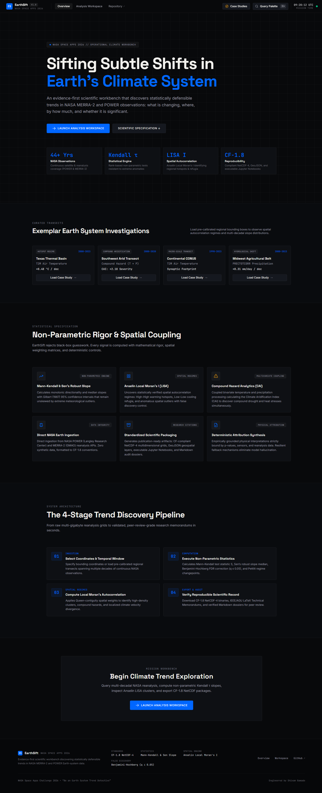
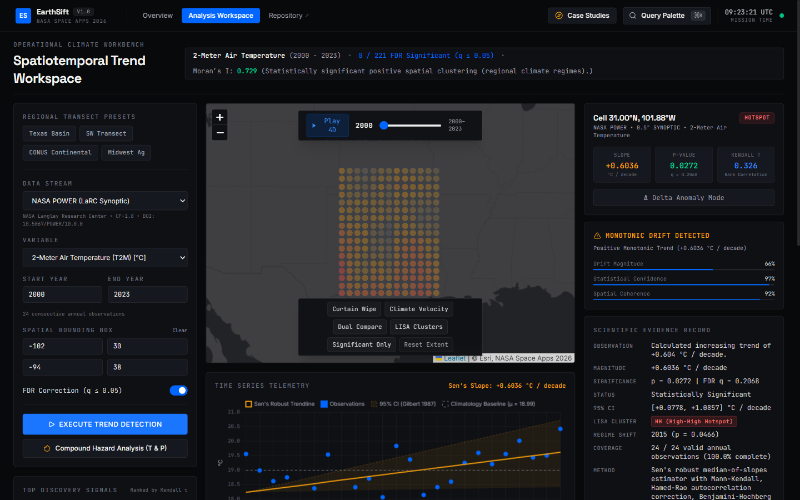
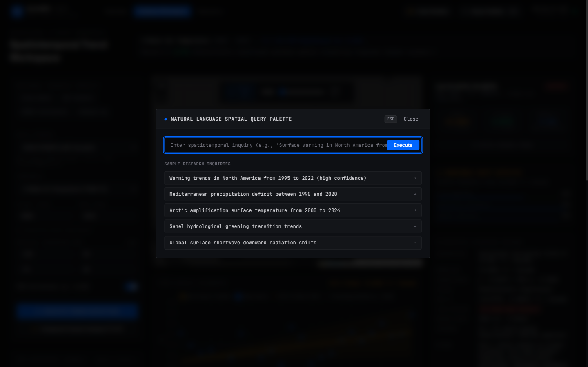
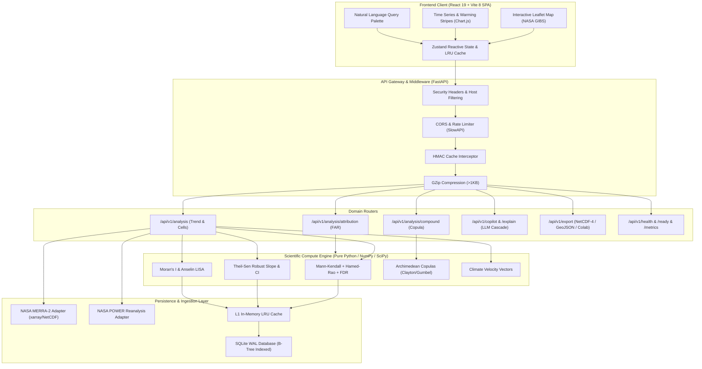

# Tellura

**Autonomous Spatiotemporal Climate Trend Discovery System for NASA Earth Observations**

Tellura is a scientific analytics workstation and spatial discovery instrument designed for the [NASA Space Apps Challenge 2026](https://www.spaceappschallenge.org/2026/challenges/be-an-earth-system-trend-detective/) (*"Be an Earth System Trend Detective"*). It analyzes gridded reanalysis and satellite observations using non-parametric statistical mechanics — overcoming the statistical fallacies common in linear climate visualization tools.

[](https://python.org)
[](https://fastapi.tiangolo.com)
[](https://react.dev)
[](https://tailwindcss.com)
[](https://scipy.org)
[](https://power.larc.nasa.gov)
[](LICENSE)
[](https://github.com/ShivamGawade-XS/NSC/actions/workflows/ci.yml)
[](https://github.com/ShivamGawade-XS/NSC/actions/workflows/security.yml)
[](https://tellura.onrender.com)

---

## Visual Interface

<p align="center">
  
</p>

<p align="center">
  
</p>

<p align="center">
  
</p>

---

## The Scientific Problem & Empirical Edge

Most climate dashboards suffer from three fundamental statistical errors:

1. **The Linearity Fallacy**: Fitting Ordinary Least Squares (OLS) regressions over decadal climate time series violates Gauss-Markov assumptions. Climate variables exhibit skewed distributions, extreme meteorological events, and non-linear transitions.
2. **Serial Autocorrelation Ignorance**: Thermal inertia in the atmosphere causes positive lag-1 autocorrelation ($r_1 > 0$). Naive trend tests underestimate variance, resulting in deflated $p$-values and high rates of false-positive detections.
3. **The Multiplicity Problem across Spatial Grids**: Evaluating trends independently across thousands of spatial cells at $\alpha = 0.05$ produces hundreds of false discoveries purely by chance.

### How Tellura Solves This

Tellura implements an end-to-end non-parametric analytical pipeline:

| Analytical Stage | Standard Dashboard Approach | Tellura Scientific Standard | Implementing Module |
| :--- | :--- | :--- | :--- |
| **Trend Significance** | Naive $t$-test / OLS $p$-value | **Mann-Kendall test with Hamed & Rao (1998) variance correction** | `backend/app/science/trend.py` |
| **Magnitude of Change** | OLS regression slope | **Theil-Sen median slope with Gilbert (1987) 95% confidence intervals** | `backend/app/science/trend.py` |
| **Spatial Multiplicity** | Unadjusted raw $p < 0.05$ | **Benjamini-Hochberg (1995) False Discovery Rate (FDR) control** | `backend/app/science/trend.py` |
| **Regime Shifts** | Arbitrary visual inflection | **Pettitt (1979) non-parametric changepoint detection** | `backend/app/science/trend.py` |
| **Spatial Clustering** | Simple color heatmap | **Local Moran's I (LISA) hotspot and coldspot classification** | `backend/app/science/spatial.py` |
| **Compound Hazards** | Single-variable analysis | **Archimedean Copula bivariate joint exceedance modeling** | `backend/app/science/copula_hazard.py` |
| **Extreme Event Attribution** | Descriptive statistics | **Fraction of Attributable Risk (FAR) framework (Stott et al., 2004)** | `backend/app/science/attribution.py` |
| **Thermal Migration** | Static maps | **Spatial Climate Velocity vectors (Burrows et al., Nature 2011)** | `backend/app/science/climate_velocity.py` |

---

## Core Mathematical Formulations

### 1. Mann-Kendall Test with Hamed & Rao (1998) Autocorrelation Correction

The Mann-Kendall statistic $S$ evaluates relative signs of all pairwise differences across $n$ temporal steps:

$$S = \sum_{k=1}^{n-1} \sum_{j=k+1}^n \text{sgn}(x_j - x_k)$$

Where the variance under independent and identically distributed observations is:

$$\text{Var}(S) = \frac{n(n-1)(2n+5) - \sum_{t} t(t-1)(2t+5)}{18}$$

To prevent spurious significance caused by serial autocorrelation, Tellura calculates the non-parametric autocorrelation of detrended ranks across all significant lags $i$, scaling the variance:

$$\text{Var}^*(S) = \text{Var}(S) \cdot \left[ 1 + \frac{2}{n(n-1)(n-2)} \sum_{i=1}^{n-1} (n-i)(n-i-1)(n-i-2) \rho_S^*(i) \right]$$

The standardized test statistic $Z$ is then computed against $\text{Var}^*(S)$:

$$Z = \begin{cases} \frac{S - 1}{\sqrt{\text{Var}^*(S)}} & \text{if } S > 0 \\ 0 & \text{if } S = 0 \\ \frac{S + 1}{\sqrt{\text{Var}^*(S)}} & \text{if } S < 0 \end{cases}$$

### 2. Theil-Sen Robust Slope & Gilbert 95% Confidence Intervals

The magnitude of temporal change is determined by the median of pairwise slopes:

$$\beta = \text{median}\left( \frac{x_j - x_k}{j - k} \right) \quad \forall \; 1 \le k < j \le n$$

This estimator possesses a 29% breakdown bound, remaining unaffected by extreme climate outliers. Gilbert (1987) two-sided 95% rank confidence bounds are derived directly from the sorted pairwise slopes.

### 3. Spatial Autocorrelation & Anselin LISA

Spatial clustering is evaluated via Global Moran's $I$:

$$I = \frac{N}{W} \frac{\sum_{i=1}^N \sum_{j=1}^N w_{ij} (z_i - \bar{z})(z_j - \bar{z})}{\sum_{i=1}^N (z_i - \bar{z})^2}$$

Grid cells are classified into spatial regimes:
- **High-High (Hotspots)**: Significant positive rate of change surrounded by similar rapid warming.
- **Low-Low (Coldspots)**: Statistically cooling/stable cells surrounded by stable cells.
- **High-Low / Low-High (Spatial Outliers)**: Microclimatic divergence from regional baselines.

---

## Tech Stack & Architecture

### Technology Stack
- **Backend**: Python 3.12+, FastAPI, Uvicorn, NumPy, SciPy, xarray, netCDF4, h5netcdf, SQLite (WAL mode with HMAC-SHA256 cache signing), SlowAPI rate limiter.
- **Frontend**: React 19, Vite 8, Tailwind CSS v4, Leaflet 1.9.4, Chart.js, Framer Motion, KaTeX, Zustand.
- **Testing & Verification**: Pytest, Hypothesis (property testing), Ruff, Pyright, Oxlint, Playwright (real browser E2E), Trivy container scanning.

### System Architecture



---

## Supported NASA Datasets

Tellura integrates data from NASA Earth Science Division missions and models via two standard adapters:

1. **NASA MERRA-2 Atmospheric Reanalysis (GMAO)**
   - Atmospheric assimilation from 1980 to present.
   - Variables: `T2M` (2-Meter Air Temperature), `PRECTOT` (Total Precipitation).
   - Baseline Fixture Coverage: North American regional transect (1980–2023).
2. **NASA POWER Project (Langley Research Center)**
   - Satellite-derived surface solar and meteorological parameters.
   - Variables: `T2M` (Air Temperature), `PRECTOTCORR` (Precipitation Corrected), `ALLSKY_SFC_SW_DWN` (Shortwave Solar Irradiance), `RH2M` (Relative Humidity), `WS10M` (10-Meter Wind Speed).

---

## Quickstart

### Prerequisites
- **Python 3.12+**
- **Node.js 20+**
- **pip** and **npm**

### Option A: Local Development (Native)

```bash
# 1. Clone repository
git clone https://github.com/ShivamGawade-XS/NSC.git
cd NSC

# 2. Install backend dependencies
pip install -r backend/requirements.txt

# 3. Install frontend dependencies
npm ci --prefix frontend-react

# 4. Start FastAPI backend (Terminal 1)
python -m uvicorn app.main:app --app-dir backend --host 127.0.0.1 --port 8000 --reload

# 5. Start Vite frontend (Terminal 2)
npm run --prefix frontend-react dev
```
Open [http://localhost:3000](http://localhost:3000) in your browser.

### Option B: Production Single-Process Mode

```bash
# Build the frontend bundle
npm run --prefix frontend-react build

# Serve both API and static frontend from FastAPI
python -m uvicorn app.main:app --app-dir backend --host 0.0.0.0 --port 8000
```
Open [http://localhost:8000](http://localhost:8000).

### Option C: Docker Compose

```bash
docker compose up --build
```
Open [http://localhost:8000](http://localhost:8000).

---

## API Reference & Usage

Interactive OpenAPI documentation is accessible at `/docs` (Swagger UI) and `/redoc` in development mode.

### 1. Health Verification
```bash
curl http://localhost:8000/api/v1/health
```
```json
{
  "status": "healthy",
  "service": "Tellura Scientific API",
  "version": "1.0.0",
  "engine": "Mann-Kendall + Theil-Sen + Benjamini-Hochberg FDR",
  "adapters": ["merra2_reanalysis", "nasa_power"]
}
```

### 2. Execute Spatiotemporal Trend Analysis
```bash
curl -X POST http://localhost:8000/api/v1/analysis \
  -H "Content-Type: application/json" \
  -d '{
    "dataset_id": "merra2_reanalysis",
    "variable_id": "T2M",
    "start_year": 2000,
    "end_year": 2020,
    "bbox": [-100.0, 30.0, -90.0, 40.0],
    "alpha": 0.05,
    "use_fdr": true
  }'
```
```json
{
  "analysis_id": "ana_merra2_reanalysis_T2M_2000_2020_b-100_30_-90_40_a50",
  "status": "completed",
  "dataset_id": "merra2_reanalysis",
  "variable_id": "T2M",
  "variable_name": "2-Meter Air Temperature",
  "display_units": "°C",
  "time_span": "2000 - 2020",
  "summary": {
    "total_cells": 121,
    "significant_cells_fdr": 0,
    "mean_slope": 0.6035,
    "spatial_autocorrelation": {
      "moran_i": -0.0326,
      "p_value": 0.6162,
      "is_clustered": false,
      "interpretation": "Spatial distribution is consistent with random spatial variation."
    }
  }
}
```

### 3. Key Endpoints Summary

| Method | Path | Description |
| :--- | :--- | :--- |
| `GET` | `/api/v1/health` | Service health and registered adapters |
| `GET` | `/api/v1/datasets` | List active NASA datasets and bounds |
| `GET` | `/api/v1/variables` | List available climate variables across datasets |
| `POST` | `/api/v1/analysis` | Run full gridded trend analysis across spatial bounds |
| `GET` | `/api/v1/analysis/{id}/map` | Retrieve spatial GeoJSON grid with LISA clustering |
| `GET` | `/api/v1/analysis/{id}/cell` | Fetch temporal timeseries, Mann-Kendall S, and changepoints for a specific cell |
| `POST` | `/api/v1/analysis/compound` | Compute bivariate compound hazard index with Archimedean copula |
| `POST` | `/api/v1/analysis/attribution` | Fraction of Attributable Risk (FAR) calculation |
| `POST` | `/api/v1/analysis/{id}/robustness` | Run bootstrap, jackknife, and temporal window robustness sweeps |
| `GET` | `/api/v1/analysis/{id}/export/netcdf` | Export analysis field as CF-1.8 NetCDF-4 binary |
| `GET` | `/api/v1/analysis/{id}/export/geojson` | Export analysis grid as standard GeoJSON FeatureCollection |
| `GET` | `/api/v1/analysis/{id}/export/colab` | Generate 1-click Google Colab reproducibility notebook link |
| `POST` | `/api/v1/explain` | Generate scientific interpretation via AI Copilot cascade |

---

## Environment Variables

All variables are optional for local development. The workstation defaults to local verified fixtures.

| Variable | Description | Default |
| :--- | :--- | :--- |
| `ENVIRONMENT` | Deployment environment (`development` / `production`) | `development` |
| `SECRET_KEY` | HMAC-SHA256 signing key for cache integrity (≥32 chars in production) | Automatic development fallback |
| `HOST` | Server host binding | `127.0.0.1` |
| `PORT` | Server port binding | `8000` |
| `DEFAULT_FDR_ALPHA` | False Discovery Rate significance alpha threshold | `0.05` |
| `MAX_BBOX_DEGREES` | Maximum spatial bounding box span permitted per axis | `180.0` |
| `STRICT_ZERO_SYNTHETIC` | Enforce NASA empirical data standard; reject synthetic generation | `true` |
| `EARTHDATA_USERNAME` | NASA Earthdata Login username for direct cloud streaming | Optional |
| `EARTHDATA_PASSWORD` | NASA Earthdata Login password for direct cloud streaming | Optional |
| `GEMINI_API_KEY` | Primary AI Copilot provider key (Google Gemini) | Optional (falls through cascade) |
| `XAI_API_KEY` | Secondary AI Copilot provider key (xAI Grok) | Optional (falls through cascade) |
| `OPENAI_API_KEY` | Tertiary AI Copilot provider key (OpenAI) | Optional (deterministic fallback) |
| `DAILY_LLM_CALL_LIMIT` | Rate limit cap on external LLM calls per day | `200` |
| `SMTP_HOST` | Outbound SMTP relay for contact form inquiries | `smtp.gmail.com` |
| `SMTP_PORT` | Outbound SMTP relay port | `587` |
| `SMTP_USER` | Outbound SMTP authentication username | Optional (inbox JSON fallback) |
| `SMTP_PASSWORD` | Outbound SMTP authentication password | Optional (inbox JSON fallback) |
| `VITE_API_URL` | Frontend API base URL override | Auto-detected from `window.location` |

See [`.env.example`](.env.example) for the full configuration template.

---

## Quality, Testing & Security Audits

### Automated Testing
The repository maintains comprehensive test coverage verified across 352 test cases:
```bash
# Run backend pytest suite
python -m pytest backend/tests/ -q

# Run frontend oxlint
npm run --prefix frontend-react lint

# Run backend ruff linter
python -m ruff check backend/

# Run backend static type checker
npx pyright backend/
```

### Security & Hardening Controls
- **Least-Privilege Containerization**: Dockerfile enforces non-root execution (`USER 10001:10001`), read-only root filesystems, and `CAP_DROP: ALL`.
- **Cache Tamper Protection**: L2 SQLite cache rows are signed with HMAC-SHA256 tokens using `SECRET_KEY`, preventing deserialization tampering.
- **Compute Guardrails**: Spatial queries enforce `MAX_BBOX_DEGREES` bounding box limits and cell-timestep complexity caps ($C \le 500{,}000$) to prevent resource exhaustion attacks.
- **Dependency CVE Auditing**: Continuous CI pipeline enforces `pip-audit`, Bandit AST security scanning, and Trivy container vulnerability analysis.

---

## Deployment

**Live URL**: [https://tellura.onrender.com](https://tellura.onrender.com)

Tellura is deployed as a single Docker container on [Render](https://render.com) (free tier). The multi-stage Dockerfile builds the React SPA, installs Python dependencies with hash verification, and runs the FastAPI server on port 8000.

### Deploy Your Own Instance

1. Fork this repository.
2. Sign up at [render.com](https://render.com) and connect your GitHub account.
3. Create a new **Blueprint** → select your forked repo → branch `main`.
4. Render auto-detects `render.yaml` and creates the web service.
5. Set the following environment variables in the Render dashboard:

| Variable | Required | Description |
|----------|:--------:|-------------|
| `SECRET_KEY` | ✅ | Auto-generated by Render Blueprint |
| `ALLOWED_ORIGINS` | ✅ | Your Render URL (e.g. `https://tellura.onrender.com`) |
| `GEMINI_API_KEY` | Optional | Google Gemini API key for AI natural language queries |
| `EARTHDATA_USERNAME` | Optional | NASA Earthdata login (app works without via fixtures) |
| `EARTHDATA_PASSWORD` | Optional | NASA Earthdata password |

6. Click **Deploy**. The first build takes ~3-5 minutes.
7. Verify at `https://<your-service>.onrender.com/api/v1/health`.

> **Note**: The free tier spins down after 15 minutes of inactivity. First request after sleep takes ~30-60 seconds.

---

## Contributing

1. Fork the repository and create your branch from `main`.
2. Write clean, tested code following non-parametric empirical guidelines.
3. Verify that all linters, type checks, and tests pass:
   ```bash
   python -m ruff check backend/
   npx pyright backend/
   npm run --prefix frontend-react lint
   python -m pytest backend/tests/ -q
   ```
4. Submit a Pull Request. GitHub Actions will run automated CI and security validation gates.

---

## License

Tellura is released under the [MIT License](LICENSE).  
Copyright (c) 2026 Shivam_Gawade.
