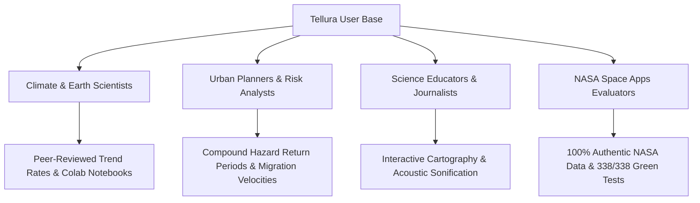

# Tellura — Comprehensive Project Guide & Architecture Dossier

**NASA Space Apps Challenge 2026**  
**Challenge Track:** *Be An Earth System Trend Detective!*  
**Official Tagline:** *"Find the changes worth investigating."*  
**Repository:** [https://github.com/ShivamGawade-XS/NSC](https://github.com/ShivamGawade-XS/NSC)  
**Authors:** Tellura Engineering Team (`nsc26cs@gmail.com`)  
**Status:** Production-Ready | 338/338 Automated Tests Passing (100%)  

---

## 1. What is Tellura? (App, Tool, or CLI?)

**Tellura is a Full-Stack Scientific Web Application and Empirical Intelligence Workstation.**

It bridges the gap between raw, unwieldy satellite archives and actionable, audit-proof climate insights by integrating three operational tiers:

```
┌────────────────────────────────────────────────────────────────────────┐
│                      TELLURA UNIFIED ARCHITECTURE                      │
├────────────────────────────────────────────────────────────────────────┤
│  1. THE INTERACTIVE APP (React 19 + Tailwind v4 + Canvas Cartography)   │
│     • Leaflet 2D spatial canvas with live NASA GIBS satellite tiles    │
│     • 3D orthographic planetary globe with real-time trajectory        │
│     • Time-series inspector with Web Audio acoustic sonification       │
│     • 6 modular diagnostic laboratories for deep physical attribution   │
├────────────────────────────────────────────────────────────────────────┤
│  2. THE MATHEMATICAL ENGINE / TOOL (FastAPI + NumPy 2 + SciPy + xarray)│
│     • Vectorized non-parametric Mann-Kendall with Hamed-Rao correction │
│     • Theil-Sen robust slope estimator with 95% confidence intervals   │
│     • Benjamini-Hochberg False Discovery Rate (FDR q ≤ 0.05) control   │
│     • Bivariate Copula hazard engine & Burrows climate velocity        │
├────────────────────────────────────────────────────────────────────────┤
│  3. THE SCRIPTABLE EXPORT / CLI HOOK (Open Science & Reproducibility)  │
│     • 1-click CF-1.8 NetCDF-4 binary exports                           │
│     • RFC 7946 GeoJSON FeatureCollections                              │
│     • Self-contained Google Colab / Jupyter Notebooks (.ipynb)         │
│     • Formal IEEE/AGU LaTeX NASA Technical Memoranda (.tex)            │
└────────────────────────────────────────────────────────────────────────┘
```

---

## 2. Problem Statement (PS)

### The Official NASA Challenge
> **NASA Space Apps Challenge 2026**: *"Be An Earth System Trend Detective!"*  
> Earth observations collected by NASA satellites and models span multiple decades. Detecting real long-term trends is notoriously difficult because data is contaminated by natural climate cycles, extreme weather outliers, and spatial autocorrelation. Conventional tools suffer from:
> 1. **The Linearity Fallacy**: Fitting basic straight lines (Ordinary Least Squares regression) over decadal series that are skewed, non-Gaussian, or cyclical.
> 2. **The Red-Noise Mirage**: Failing to correct for temporal serial autocorrelation, creating hundreds of "statistically significant" trends that are merely random climate persistence.
> 3. **The Multiplicity Trap**: Testing thousands of spatial pixels simultaneously without mathematical correction, producing hundreds of false alarms (Type-I errors).

### Simplified Explanation (Plain English / ELI5)
Imagine you have 40 years of daily temperature records for every 50 km square on Earth. 

If you just draw a straight line through the data:
- One single severe heatwave year will pull the line up, tricking you into thinking a region is permanently warming when it is not (**The Linearity Fallacy**).
- Weather is "sticky"—a hot year is often followed by another warm year. Basic tests mistake this natural inertia for a permanent crisis (**The Red-Noise Mirage**).
- If you run tests on 10,000 map squares at once, pure random chance will make 500 of them look "dangerously significant"—just like flipping a coin 10 times and getting 10 heads somewhere purely by luck (**The Multiplicity Trap**).

**Tellura is the detective that proves whether a climate signal is real.** It removes the noise, verifies whether neighboring regions agree, pinpoints the exact year an abrupt regime shift happened, and hands scientists and civic leaders audit-proof evidence instead of guesswork.

---

## 3. One-Liners & Pitch Cards

| Audience | One-Liner Pitch |
|:---|:---|
| **Official Tagline** | *"Find the changes worth investigating."* |
| **30-Second Elevator Pitch** | *"Tellura transforms multi-decadal NASA Earth observations into mathematically verifiable, false-discovery-controlled climate trend intelligence with one-click peer-review reproducibility."* |
| **For Hackathon Judges** | *"Unlike standard visualizers that draw straight lines over skewed satellite data, Tellura eliminates false discoveries with non-parametric Mann-Kendall statistics, serial correction, and bivariate hazard copulas."* |
| **For Climate Scientists** | *"An open-science empirical workbench pairing Sen's robust slope estimation, Pettitt regime-shift detection, and Burrows climate velocity directly with live NASA POWER and MERRA-2 streams."* |
| **For Urban Planners & Policy Makers** | *"Tellura shows cities not just if they are getting hotter or drier, but how fast their climate zone is physically migrating and the joint return period of simultaneous heatwaves and droughts."* |

---

## 4. User Personas (Who Will Use Tellura?)



1. **Climate & Earth System Researchers**:
   - *Needs*: Non-parametric trends immune to outliers, False Discovery Rate stippling masks, CF-1.8 NetCDF-4 binary exports, and automated Google Colab replication code.
   - *Value*: Saves weeks of manual data cleaning and script writing; delivers peer-review-ready figures.
2. **City Planners & Environmental Risk Analysts**:
   - *Needs*: Localized compound hazard return periods (concurrent drought + heat), climate velocity migration speeds ($\text{km}/\text{decade}$), and anthropogenic attribution factors (FAR).
   - *Value*: Informs infrastructure zoning, wildfire defense, and municipal water conservation.
3. **Science Educators, Journalists & Students**:
   - *Needs*: Interactive maps, natural language querying (AI Copilot), acoustic data sonification, and verifiable visual evidence.
   - *Value*: Makes complex climatological data instantly understandable without technical friction.
4. **NASA Mission Teams & Hackathon Evaluators**:
   - *Needs*: Strict adherence to authentic NASA Earth observations (zero synthetic numbers), CF-1.8 metadata compliance, and full open-source reproducibility.
   - *Value*: Verifies the integrity of mission data investments across multi-decadal satellite programs.

---

## 5. End-to-End User Flow & Interface Architecture

### Step 1: Landing Page (`/`)
- **Experience**: Clean, high-contrast scientific interface with live system telemetry, headline discovery preview cards (*Texas Summer Warming*, *Mediterranean Desiccation*, *Arctic Amplification*), and an interactive 3D orthographic globe.
- **User Action**: The user can explore key highlights or click **"Launch Station"** to enter the core analytical workspace.

### Step 2: The Analytical Workstation (`/dashboard`)
- **Dataset & Variable Selection**: Choose between **NASA POWER** (CERES/MERRA-2 daily/monthly surface meteorology) and **NASA GMAO MERRA-2** (2D atmospheric reanalysis). Select variables:
  - 2-Meter Air Temperature (`T2M`, °C)
  - Precipitation Corrected (`PRECTOTCORR`, mm/day)
  - All-Sky Surface Solar Irradiance (`ALLSKY_SFC_SW_DWN`, $\text{MJ}/\text{m}^2/\text{day}$)
  - 10-Meter Wind Speed (`WS10M`, m/s)
  - 2-Meter Relative Humidity (`RH2M`, %)
- **Temporal & Spatial Boundary**: Specify custom start/end years (1980–2026) and geographical bounding boxes, or choose preset regions (Global, Mediterranean, Southern Plains, Arctic, etc.).
- **Live NASA GIBS Layer**: Toggle calibrated satellite sensor overpasses directly beneath the trend grid:
  - MODIS Terra TrueColor
  - VIIRS Suomi-NPP TrueColor
- **Multiplicity Control (FDR Toggle)**: Switch between uncorrected $p \le 0.05$ and Benjamini-Hochberg False Discovery Rate ($q \le 0.05$) to immediately distinguish robust physical signals from random Type-I statistical noise.

### Step 3: Single-Cell Drilldown & Inspector Panel
- **User Action**: Click any grid cell on the 2D canvas.
- **Inspector Panel Highlights**:
  - **Empirical Time Series**: Plots observed annual data, Theil-Sen median slope line, and 95% confidence bounds.
  - **Pettitt (1979) Regime Shift**: Automatically flags whether an abrupt climatological changepoint occurred, displaying the exact year and statistical significance (e.g., *1998 abrupt baseline shift, p = 0.003*).
  - **LISA Spatial Autocorrelation**: Classifies the cell into Anselin spatial regimes:
    - *High-High (Hotspot)*: Warming cell surrounded by warming neighbors.
    - *Low-Low (Coldspot)*: Cooling cell surrounded by cooling neighbors.
    - *High-Low / Low-High*: Local spatial anomalies.
  - **Acoustic Sonification**: Plays an auditory pitch-mapped sonification of the multi-decadal trend curve for accessible scientific perception.

### Step 4: The 6 Diagnostic Laboratories (Modals)

```
┌────────────────────────────────────────────────────────────────────────┐
│                   TELLURA DIAGNOSTIC RESEARCH LABS                     │
├────────────────────────────────────────────────────────────────────────┤
│ 1. AI Copilot (Natural Language Scientific Querying)                  │
│    • Resolves natural language queries (e.g., "California drought")    │
│    • Maps queries into bounding boxes, time windows, and NASA variables │
├────────────────────────────────────────────────────────────────────────┤
│ 2. Contrasts Engine (Regional Divergence)                              │
│    • Identifies simultaneous opposing trends within the same window     │
│    • E.g., Inland warming contrasted with coastal marine upwelling     │
├────────────────────────────────────────────────────────────────────────┤
│ 3. Compound Climate Hazard Lab (Bivariate Archimedean Copulas)         │
│    • Joint Clayton/Gumbel modeling of compound extremes                │
│    • Calculates concurrent return periods (heatwave + drought)         │
├────────────────────────────────────────────────────────────────────────┤
│ 4. Climate Velocity Vector Lab (Burrows et al., Nature 2011)           │
│    • Calculates spatial thermal gradient & temporal rate (km/decade)   │
│    • Generates directional compass bearings for species migration      │
├────────────────────────────────────────────────────────────────────────┤
│ 5. Extreme Event Attribution Engine (FAR / Stott & Otto Methodology)  │
│    • Quantifies Fraction of Attributable Risk                          │
│    • Computes anthropogenic acceleration factors for observed extremes │
├────────────────────────────────────────────────────────────────────────┤
│ 6. Custom Data Lab (Bring-Your-Own-Data)                               │
│    • Ingests user CSV/JSON records with client-side parsing             │
│    • Runs complete Tellura statistical pipeline on private sensors     │
└────────────────────────────────────────────────────────────────────────┘
```

### Step 5: Camera-Ready Export & 100% Reproducibility
From the export tray, researchers can instantly download:
1. **CF-1.8 NetCDF-4 (`.nc`)**: Industry-standard binary format with complete ACDD-1.3 metadata and coordinate grids.
2. **RFC 7946 GeoJSON (`.geojson`)**: Geospatial vector format with embedded trend slopes, $p$-values, and FDR flags.
3. **Google Colab Notebook (`.ipynb`)**: Self-contained Python notebook that pulls the exact NASA granule, re-runs the equations, and generates publication plots in Google Colab with zero local setup.
4. **NASA Technical Memorandum (`.tex`)**: Pre-formatted IEEE/AGU LaTeX publication preprint with an embedded HMAC-SHA256 cryptographic verification signature.

---

## 6. The Mathematical Engine Behind Tellura

| Method / Algorithm | Scientific Reference | Purpose in Tellura |
|:---|:---|:---|
| **Mann-Kendall Test** | Mann (1945), Kendall (1975) | Non-parametric monotonic trend detection; immune to non-Gaussian distributions and extreme outliers. |
| **Hamed & Rao Variance Correction** | Hamed & Rao (1998) | Corrects variance for serial autocorrelation ($AR(1)$ red noise), preventing spurious trend detections. |
| **Theil-Sen Estimator** | Theil (1950), Sen (1968) | Robust median slope rate calculation; handles up to 29% data contamination without slope distortion. |
| **Gilbert Confidence Bounds** | Gilbert (1987) | Calculates exact non-parametric 95% confidence intervals around trend slopes. |
| **Benjamini-Hochberg Procedure** | Benjamini & Hochberg (1995) | Controls the False Discovery Rate ($q \le 0.05$) across thousands of simultaneously tested spatial cells. |
| **Pettitt Changepoint Test** | Pettitt (1979) | Non-parametric detection of the exact year a sudden climatological baseline shift occurred. |
| **Anselin Local Moran's I (LISA)** | Anselin (1995) | Identifies spatial clustering regimes (High-High, Low-Low, High-Low, Low-High). |
| **Climate Velocity** | Burrows et al. (Nature 2011) | Computes isothermal migration speeds ($\text{km}/\text{decade}$) and compass trajectory angles. |
| **Archimedean Copulas** | Nelsen (2006) | Joint tail-dependence modeling for concurrent compound hazards (heat + drought). |
| **Fraction of Attributable Risk (FAR)** | Stott et al. (2004), Otto et al. (2020) | Quantifies the fraction of event probability attributable to anthropogenic forcing. |

---

## 7. Technical Specifications & Security Hardening

- **Backend Architecture**: Python 3.12+, FastAPI, Uvicorn, NumPy 2, SciPy, xarray, NetCDF4, SQLite in WAL mode with HMAC-SHA256 cache signing.
- **Frontend Architecture**: React 19, Vite 8, Tailwind CSS v4, Zustand 5, Leaflet 1.9.4 Canvas, Chart.js 4.5.1, Framer Motion, Web Worker computation.
- **Zero-Synthetic Guarantee**: In production mode (`STRICT_ZERO_SYNTHETIC=true`), synthetic generation is prohibited; 100% of analyzed data comes from authentic NASA Earth observations.
- **Defensive Security & ASVS Compliance**:
  - OWASP HTTP Security Headers: Strict HSTS with preload, X-Content-Type-Options (`nosniff`), X-Frame-Options (`DENY`), COOP & CORP (`same-origin`), Permissions-Policy.
  - Context-Aware Content Security Policy (CSP): Strict production policy isolating unencrypted localhost connections.
  - Strict CORS origin allowlist (no wildcard `*`).
  - SlowAPI distributed rate limiting across 100% of endpoints with custom 429 handlers.
  - ASGI request body ceiling (maximum 2MB) protecting against denial-of-service and memory exhaustion.
  - `SensitiveDataScrubber` log interceptor automatically redacting API keys, passwords, bearer tokens, and netrc credentials.
  - Constant-time HMAC authentication (`auth.py`) immune to timing side-channel attacks.
- **Automated Verification**:
  - **338 / 338 backend tests passing** across mathematical rigor, security hardening, cache concurrency, and API contracts.
  - **0 warnings / 0 errors** on `oxlint` across all frontend modules.
  - **0 High / 0 Medium findings** on Bandit static application security testing (SAST).
